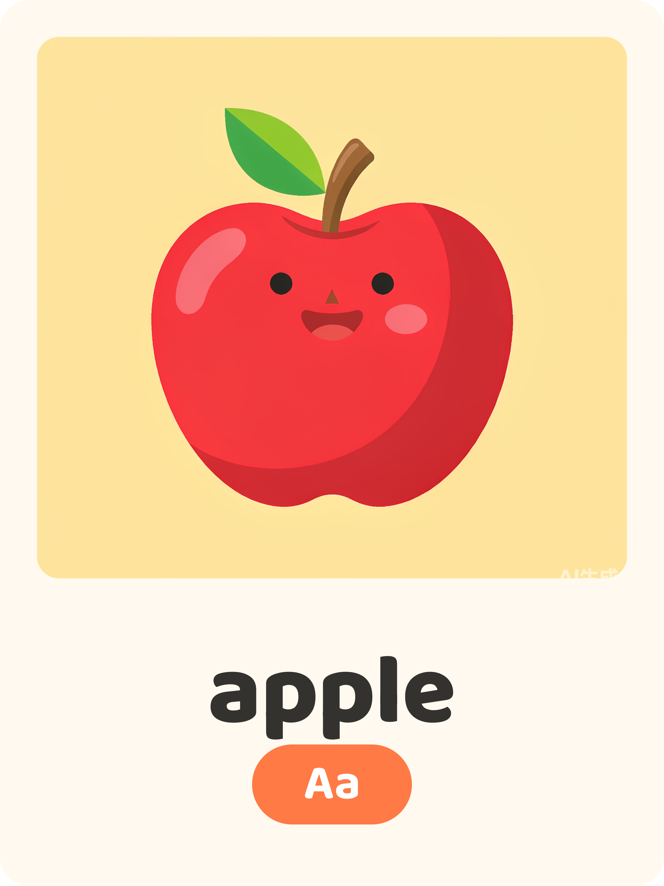
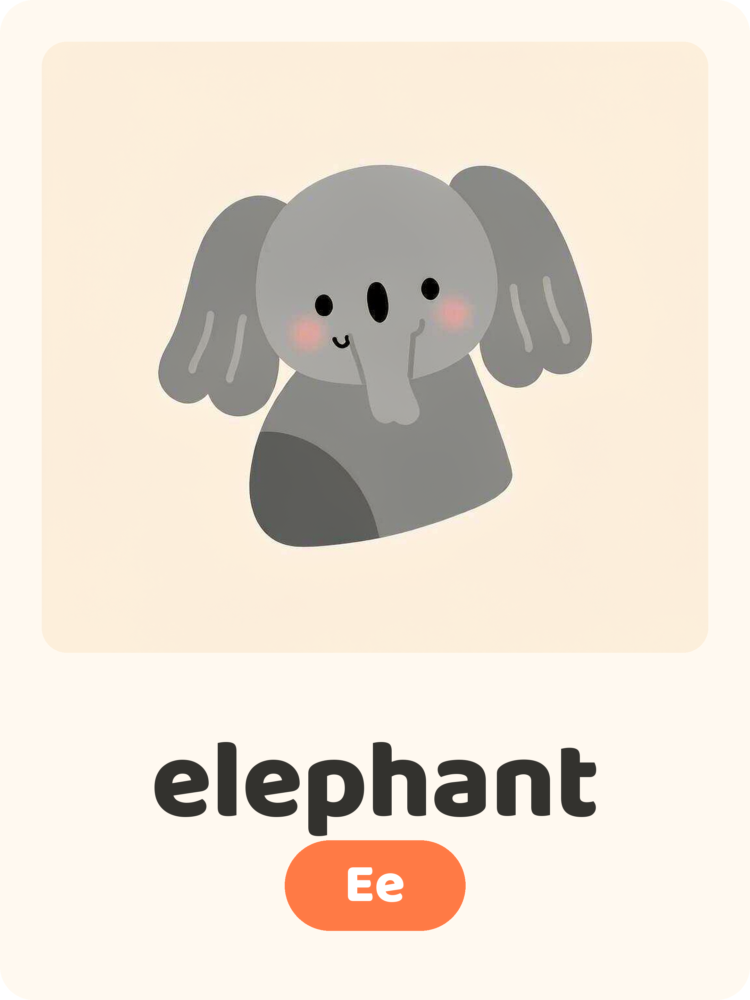
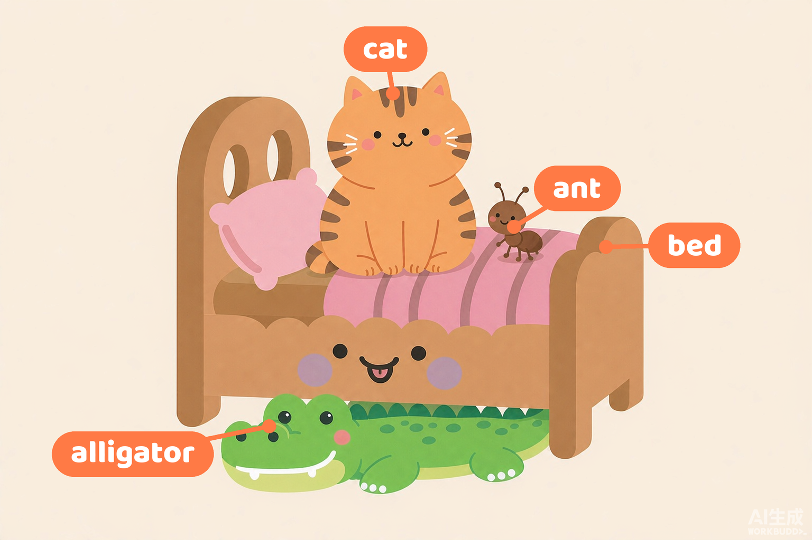

# english-preschool-materials

英语幼教素材批量生成 Skill：把一份简单的 Excel 词表，批量变成风格统一、可直接打印的 **kawaii 英语单词闪卡** 和 **歌谣（Chant）场景插图**。



## 效果示例

| 单词闪卡 | Chant 场景图（含单词标注） |
|---|---|
|  |  |

## 它做什么

**流水线 A · 单词闪卡**：读取 `单词.xlsx`（A 列英文 / B 列重点字母 / C 列中文释义），为每个单词生成一张 1080×1440 竖版卡片——kawaii 扁平插画 + 单词 + 橙色字母徽章，导出 PNG。

**流水线 B · Chant 场景插图**：读取 `Chant.xlsx`（A 列歌词），用已生成的角色底图做 image-to-image，生成 1536×1024 横版多角色场景图，并把单词表里的词以橙色胶囊标注到图上（不在词表里的主体严禁标注）。

两条流水线共用同一套画风锁定词、角色底图（`subject-*.png`）、字体与配色。

## 安装

把本仓库整个目录放入你的 Agent 技能目录：

- **WorkBuddy**：用户级 `~/.workbuddy/skills/english-preschool-materials/`（全项目可用）或项目级 `<项目>/.workbuddy/skills/english-preschool-materials/`（仅本项目）
- **Claude Code 等兼容环境**：放入对应的 skills 目录即可

依赖：

- 能按提示词生成图片的工具（WorkBuddy ImageGen / 任意文生图服务，提示词模板通用）
- Python 3.x + `pip install pillow numpy openpyxl`

## 快速开始

1. 准备 `单词.xlsx`（格式见 [SKILL.md §1](SKILL.md)）
2. 对你的 Agent 说：

   > 按 xlsx 帮我批量做英语单词卡

3. Agent 会先报「X 张、约 Y 生图额度」，确认后开跑，成品落在 `card-exports/`

详细规格（提示词模板、排版参数、标注规则、踩坑备忘）全部在 [SKILL.md](SKILL.md)。

## 目录结构

```
english-preschool-materials/
├── SKILL.md                    # 技能主文件（完整规格与流程）
├── README.md
├── LICENSE
├── scripts/
│   ├── card_compose.py         # 单词卡本地合成（含去水印）
│   ├── chant_annotate_auto.py  # 场景图单词胶囊自动标注
│   ├── chant_annotate.py       # 标注（手动 labels 版）
│   ├── chant_analyze.py        # 主体定位分析工具
│   └── chant_components.py     # 标注组件（胶囊/引线）
├── assets/fonts/
│   └── baloo2-extrabold.ttf    # Baloo 2 ExtraBold
└── examples/                   # 成品示例
```

## 设计原则

- **画面极简**：卡片上主体唯一、零干扰元素，一眼建立「图 ↔ 单词」关联
- **中文不上卡**：规避母语依赖与多义词歧义
- **逐字符照抄**：词表内容严禁被 AI「好心」改写
- **角色一致性**：单词卡与场景图复用同一套 `subject-*.png` 底图

## License

[MIT](LICENSE) © archer860710
